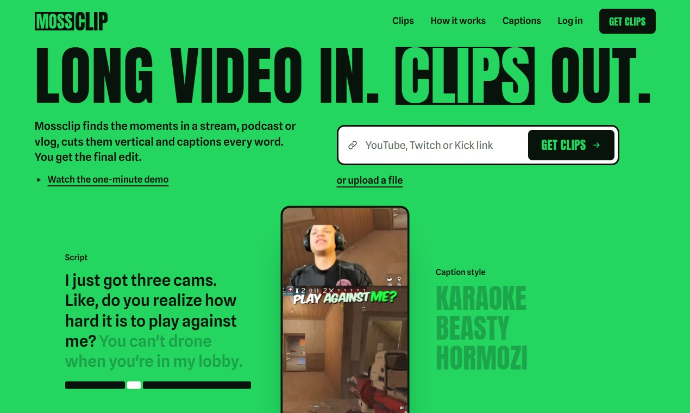

# Mossclip

**Mossclip turns Twitch, Kick and YouTube streams into Shorts and TikToks, and clips Twitch and Kick while you are still live.** Facecam on top, captions in your language, a whoosh to open and a vine boom on the funny moment, 3D emojis, and a share link for every clip. It also clips podcasts, interviews and vlogs, and opens every clip in an editor so the final cut is yours.

Website: **https://mossclip.com/en**

The creators shown in the screenshot are not affiliated with Mossclip.

This repository holds no source code. It is the public information page for the product Mossclip. Mossclip was called TwoReel until October 2026, and links to tworeel.com lead to mossclip.com.

## What you give it

- **A Twitch or Kick channel while it is live** (`twitch.tv/name` or `kick.com/name`). The latest two hours come back as clips before the stream ends.
- **A Twitch recording link** (the address with `twitch.tv/videos` in it).
- **A Kick recording link** (from the channel's videos on Kick).
- **A YouTube link.** A live YouTube stream is clipped from its recording: paste the link once that stream has ended.
- **A Google Drive or Dropbox link, or a direct video address.**
- **An MP4 or MOV file.**

One job takes up to two hours of video. A longer recording is accepted when you give it as a link: you choose which part to clip by dragging a block along the recording, pressing a chapter, or typing the start and end times. Run another job for the next part, and a recording of any length is covered two hours at a time.

There is nothing to download or upload and no channel to connect. The link is enough.

## Clip a stream while it is live

Paste a live Twitch or Kick channel and Mossclip turns its latest two hours into Shorts while the stream is still on. **On a paid plan, tick Keep clipping and every new two hours becomes clips on its own until the stream ends** (up to 48 hours).

On 19 November 2026, Kai Cenat's live Twitch channel, pasted more than 13 hours into his GTA 6 launch stream, came back as 11 clips of the latest two hours 26 minutes later. Kai Cenat is not affiliated with Mossclip.

## What you get

- **Vertical clips, 1080 by 1920, between 15 seconds and 3 minutes long. No watermark.** Up to 12 clips from one long video, scored and listed best first.
- **Every word captioned and timed, in nine caption styles and more than 30 languages,** including English, Spanish, Portuguese, Hindi, Russian, Serbian, Turkish, Arabic, French and German. Captions and titles follow the language the streamer speaks, even when the game is in another language.
- **A headline on top, or none.** New project has a Headline on top switch: On puts a short hook line above every clip, Off leaves just the video and its captions. On Twitch and Kick streams the hook names the streamer.
- **Sound effects.** Every clip opens with a whoosh, and gets a vine boom on the punchline, the crash or the "oh no" moment when there is one. Pick another sound or turn it off before a job, or change it on any finished clip.
- **3D emojis** drawn into the clip.
- **Facecam over gameplay.** On gameplay streams the facecam is found and stacked over the game, so a clip keeps both the reaction and the play. Drawn avatars (VTubers, PNGtubers) get the same layout. Move either crop, save the layout, apply it to the whole batch and pick it again for the next job.
- **A share link for every clip.** The Share button gives a page that plays that one clip, so you can send it to the streamer or a friend before posting it anywhere.
- **An editor.** Every clip opens with its transcript beside the video. Select words, press Backspace, and the clip loses exactly those seconds. Change the caption style, retype any word, move the crops and export again.
- **Posting.** Send a finished clip straight to your YouTube channel as a Short, schedule it, or send it to your phone with a QR code.
- **Three styled looks.** Blackboard, Notebook and Collage draw a clip in chalk, pen or cut-out paper ([see them](https://mossclip.com/en/looks)).
- Clips stay available for 15 days from the day they are made. Download the ones you want to keep.

## Who it is for

- **Streamers** who want Shorts, TikToks and Reels from a stream, with no editing.
- **Clippers and clipping agencies** who cut other creators' recordings for short-form platforms. You do not need access to the creator's channel, only footage you have the right to clip.
- **Podcasters and interview shows.**

## How it works

1. **Paste a link.** A live Twitch or Kick channel, a recording, a YouTube video or a file. Leave the rules on auto, or say what you are after in a sentence.
2. **Get a batch, not a guess.** Mossclip reads what was said, listens for the loud moments and looks at the screen, so a clutch or a jump scare with nothing said is still found. On the site's example job it read a 59-minute interview, found 36 moments and kept the best 9.
3. **Cut by deleting words.** The transcript sits beside the video. Select words, press Backspace, and the clip is shorter by exactly those seconds.
4. **Post it.** Download one clip or the whole batch, send it to YouTube, or share its link.

More detail: [docs/how-it-works.md](docs/how-it-works.md).

## Pricing

Prices are in US dollars, before tax. This is the pricing page as it stands today ([mossclip.com/en/pricing](https://mossclip.com/en/pricing)).

| Plan | Price | Video a month | Styled clips a month |
| --- | --- | --- | --- |
| Starter | $9 a month | 4 hours | 5 |
| Creator | $29 a month (**$19 founding price**) | 13 hours | 30 |
| Studio | $79 a month | 40 hours | 60 |

- **Creator founding price: $19 a month for as long as you stay, if you subscribe by 26 November 2026.**
- **No subscription: 2 hours of video for $5,** bought once. It does not expire.
- **10 more styled clips for $5,** bought once. They do not expire.
- **Regional prices.** In many countries the checkout shows a lower price for your country, up to 30% off (India: about ₹1,285 a month for Creator at the founding price, plus tax). Studio is the same price everywhere.
- **Free start:** sign up with Google and your first 30 minutes of video are free. Join the Mossclip Discord server and register your account email to raise that to 2 hours in total, plus 2 styled clips, once.
- Every plan includes links from YouTube, Twitch and Kick or your own file, vertical 1080p clips with word-by-word captions, the camera stacked over gameplay for streams, the editor, no watermark, and clips kept for 15 days.
- Source video is counted by its length: a two-hour stream uses two hours. Every job counts as at least 10 minutes. A job that fails on Mossclip's side gives back what it used. **Unused hours carry over for one month, even if you cancel.**
- Cancel at any time from your billing page and keep the plan until the end of the period you paid for. The first payment is refunded in full within 7 days if you have used less than a quarter of the allowance.

Paid plans also get Autopilot (add a Twitch or YouTube channel once, and each new stream or video is clipped on its own) and Keep clipping for live streams. Refer someone and earn 30% of what they pay, for life ([referrals](https://mossclip.com/en/referrals)).

## How to start

**Anyone can sign up, with Google or an email link,** on the [sign-in page](https://mossclip.com/en/login). With Google, your first 30 minutes of video are free. Subscribe from the billing page in your account, or buy the $5 pack.

## Questions

**Can Mossclip clip a Twitch or Kick stream while it is live?** Yes. Paste the live channel's link while the stream is on, and its latest two hours become Shorts before it ends. On a plan, Keep clipping does every new two hours until the stream ends.

**Is there a watermark?** No. Every clip is exported at the full 1080 by 1920 with no watermark, on the free start too.

**Which languages do captions support?** More than 30, including English, Spanish, Portuguese, Hindi, Russian, Serbian, Turkish, Arabic, French and German.

**Can I turn the headline off?** Yes. New project has a Headline on top switch.

**Can I clip a stream longer than two hours?** Yes. Paste the link of the whole recording and choose which two hours to clip, then run another job for the next part.

**Can I use it for client work?** Yes, with footage you own or have permission to clip. The finished files are yours to deliver.

**How long do my clips stay available?** Fifteen days from the day they are made.

More questions and answers: [docs/faq.md](docs/faq.md).

## Pages

- [Home](https://mossclip.com/en), [Pricing](https://mossclip.com/en/pricing), [About](https://mossclip.com/en/about), [Changelog](https://mossclip.com/en/changelog), [Looks](https://mossclip.com/en/looks), [Refer and earn](https://mossclip.com/en/referrals), [Contact](https://mossclip.com/en/contact)
- [Terms](https://mossclip.com/en/terms), [Privacy](https://mossclip.com/en/privacy), [Refunds](https://mossclip.com/en/refunds)
- The homepage and many pages are also in [Spanish](https://mossclip.com/es) and [Brazilian Portuguese](https://mossclip.com/pt).

Tools:

- [Clip a stream while it's live](https://mossclip.com/en/tools/live-stream-clipper)
- [GTA 6 streams to Shorts](https://mossclip.com/en/tools/gta-6-stream-to-shorts)
- [YouTube stream to Shorts](https://mossclip.com/en/tools/youtube-stream-to-shorts)
- [Twitch VOD to TikTok](https://mossclip.com/en/tools/twitch-vod-to-tiktok)
- [Kick clip maker](https://mossclip.com/en/tools/kick-clip-maker)
- [Kick VOD to clips](https://mossclip.com/en/tools/kick-vod-to-clips)
- [Facecam and gameplay vertical clips](https://mossclip.com/en/tools/facecam-gameplay-vertical-clips)
- [VTuber and PNGtuber clip maker](https://mossclip.com/en/tools/vtuber-clip-maker)
- [Podcast clip generator](https://mossclip.com/en/tools/podcast-clip-generator)
- [Long video to Shorts](https://mossclip.com/en/tools/long-video-to-shorts)
- [Free AI clip maker, no watermark](https://mossclip.com/en/tools/ai-clip-maker-free-no-watermark)

Free tools in the browser, no sign-up:

- [Caption style preview](https://mossclip.com/en/tools/caption-style-preview) (a typed line in all nine caption styles)
- [Kick clip and VOD downloader](https://mossclip.com/en/tools/kick-downloader)
- [Add a text bar to a video](https://mossclip.com/en/tools/add-text-bar-to-video)
- [Add a vine boom to a video](https://mossclip.com/en/tools/add-vine-boom-to-video)

Made for:

- [Streamers](https://mossclip.com/en/for/streamers)
- [Clippers](https://mossclip.com/en/for/clippers)
- [Clipping agencies](https://mossclip.com/en/for/clipping-agencies)
- [Podcasters](https://mossclip.com/en/for/podcasters)

Guides:

- [GTA 6 clipping guide](https://mossclip.com/en/guides/gta-6-clipping)
- [How to run a clip channel from live streams](https://mossclip.com/en/guides/cortes-de-lives)
- [Clip a long stream into Shorts](https://mossclip.com/en/guides/clip-a-long-stream-into-shorts)
- [Vertical gaming clips with a facecam](https://mossclip.com/en/guides/vertical-gaming-clips-with-facecam)
- [Clip a podcast into Shorts and Reels](https://mossclip.com/en/guides/clip-a-podcast-for-shorts)
- [How paid clipping on Whop works](https://mossclip.com/en/guides/whop-clipping-how-it-works)
- [Best clipping tools for paid clippers](https://mossclip.com/en/guides/best-clipping-tools-for-clippers)
- [Best AI clipping tools for streamers](https://mossclip.com/en/guides/best-ai-clipping-tools-for-streamers)

Comparison pages:
[OpusClip](https://mossclip.com/en/compare/opus-clip-alternative),
[StreamLadder](https://mossclip.com/en/compare/streamladder-alternative),
[Eklipse](https://mossclip.com/en/compare/eklipse-alternative),
[Submagic](https://mossclip.com/en/compare/submagic-alternative),
[Klap](https://mossclip.com/en/compare/klap-alternative),
[StreamClipped](https://mossclip.com/en/compare/streamclipped-alternative),
[Powder](https://mossclip.com/en/compare/powder-alternative),
[Vizard](https://mossclip.com/en/compare/vizard-alternative),
[WayinVideo](https://mossclip.com/en/compare/wayin-alternative),
[Choppity](https://mossclip.com/en/compare/choppity-alternative),
[quso.ai](https://mossclip.com/en/compare/quso-alternative),
[Ssemble](https://mossclip.com/en/compare/ssemble-alternative),
[Clypse](https://mossclip.com/en/compare/clypse-alternative),
[ClipMe](https://mossclip.com/en/compare/clipme-alternative),
[StreamGen](https://mossclip.com/en/compare/streamgen-alternative),
[Cut.Pro](https://mossclip.com/en/compare/cut-pro-alternative),
[Descript](https://mossclip.com/en/compare/descript-alternative),
[Riverside Magic Clips](https://mossclip.com/en/compare/riverside-magic-clips-alternative),
[SendShort](https://mossclip.com/en/compare/sendshort-alternative),
[Crayo](https://mossclip.com/en/compare/crayo-alternative).

For AI tools, the site also publishes a plain-text summary: [mossclip.com/llms.txt](https://mossclip.com/llms.txt).

## Contact

Use the [contact page](https://mossclip.com/en/contact). The site aims to reply within 3 working days. Mossclip is run from India. You can also reach out on the Mossclip Discord server.

## About this repository

This repository holds no source code. It is the public information page for Mossclip, and the website at https://mossclip.com/en is the source of truth. If this page and the website differ, the website is right. See [CHANGELOG.md](CHANGELOG.md) for dated changes.
